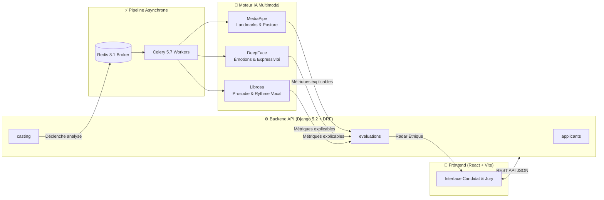

<div align="center">

<!-- HERO BANNER -->


<br/>

<!-- ANIMATED TYPING HEADER -->
<a href="[https://github.com/ismailkrid957-dot/spider-el-3ankabout](https://github.com/ismailkrid957-dot/spider-el-3ankabout)">
  
</a>

<p align="center">
  <strong>Tisser une toile d'évaluation objective, transparente et inclusive pour réinventer le casting artistique.</strong>
</p>

<!-- BADGES -->
<p align="center">
  
  
  
  
  
</p>

<p align="center">
  <a href="#-démonstration-vidéo">🎬 Démo Vidéo</a> •
  <a href="#-engagement--ia-éthique-360--jei-insat--oif">⚖️ IA Éthique 360</a> •
  <a href="#-architecture-technique">🕸️ Architecture</a> •
  <a href="#-installation-rapide">🚀 Installation</a>
</p>

</div>

---

## 🌟 Pourquoi « Spider Casting » (El 3ankabout) ?

Dans l'industrie culturelle et cinématographique, le processus de casting souffre souvent d'opacité, de biais inconscients et d'une surcharge de candidatures qui pénalise les talents émergents — notamment au sein de l'espace francophone.

**Spider Casting (*El 3ankabout*)** agit comme une **toile d'analyse multimodale bienveillante** : plutôt que de réduire un(e) artiste à une boîte noire opaque, notre moteur tisse ensemble des signaux objectifs (expressivité faciale, posture scénique, prosodie vocale) pour générer un **profil radar explicable**, toujours soumis à la validation finale d'un jury humain.

<div align="center">
  
</div>

---

## 🎬 Démonstration Vidéo

> 💡 **Aperçu du parcours complet** : dépôt d'une audition vidéo, traitement asynchrone via Celery/Redis, extraction multimodale et restitution du score radar explicable.

<div align="center">

<!-- ASTUCE GITHUB : Pour afficher un lecteur vidéo natif ici, glisse-dépose simplement ton fichier .mp4 directement dans l'éditeur README sur GitHub.com — GitHub générera automatiquement le lien [https://github.com/user-attachments/assets/](https://github.com/user-attachments/assets/)... -->

[](https://github.com/ismailkrid957-dot/spider-el-3ankabout)

*🎥 Cliquez sur la bannière ou glissez votre vidéo `.mp4` de démonstration directement dans cette section sur GitHub.*

</div>

---

## ⚖️ Engagement « IA Éthique 360 » (JEI INSAT × OIF)

Conçu dans le cadre du **Hackathon IA Éthique 360** co-organisé par la **Junior Entreprise INSAT (JEI)** et l'**Organisation Internationale de la Francophonie (OIF)** (*Mandat JEI 2026/2027*), le projet repose sur 4 piliers non négociables :

| Pilier Éthique | Implémentation dans Spider Casting |
| :--- | :--- |
| 🔍 **Explicabilité (XAI)** | Aucun score global opaque : chaque évaluation est décomposée par critère artistique (prosodie, expressivité, posture) dans `evaluations`. |
| 🛡️ **Neutralisation des biais** | Analyse centrée uniquement sur la performance artistique (landmarks géométriques & acoustiques) sans profilage morphologique ou identitaire. |
| 🤝 **Human-in-the-Loop** | L'IA assiste le tri et met en lumière des talents atypiques ; **la décision de casting reste 100 % humaine**. |
| 🌍 **Inclusivité Francophone** | Calibration acoustique ouverte à la diversité des accents et expressions culturelles de l'espace francophone (OIF). |

---

## 🕸️ Architecture Technique

Le projet adopte une architecture découplée pensée pour absorber les traitements vidéo/audio lourds sans bloquer l'expérience utilisateur :



### Structure du dépôt

```text
spider-el-3ankabout/
├── backend/
│   ├── ai/                 # Extraction multimodale (MediaPipe, DeepFace, Librosa)
│   ├── applicants/         # Profils candidats et dépôt des auditions
│   ├── casting/            # Projets, scénarios et rôles de casting
│   ├── evaluations/        # Scores décomposés et critères explicables (XAI)
│   ├── config/             # Configuration Django, Celery et routage API
│   ├── manage.py
│   └── docker-compose.yml  # Broker Redis pour les tâches asynchrones
├── frontend/
│   ├── public/
│   ├── src/                # Composants React, visualisation Radar et client Axios
│   └── package.json
├── docs/
│   └── assets/             # Bannière, schémas SVG et visuels du README
├── .gitignore
└── README.md
```

---

## 🚀 Installation Rapide

### Prérequis

* **Python** 3.11+
* **Node.js** 18+ et **npm**
* **Docker** *(pour lancer Redis)*

### 1. Cloner le dépôt

```bash
git clone https://github.com/ismailkrid957-dot/spider-el-3ankabout.git
cd spider-el-3ankabout
```

### 2. Démarrer le Backend & le Worker IA (`backend/`)

```bash
cd backend
```

**Créer et activer l'environnement virtuel :**

* **Windows (PowerShell) :**
  ```powershell
  python -m venv .venv
  .\.venv\Scripts\Activate.ps1
  ```
* **Linux / macOS :**
  ```bash
  python3 -m venv .venv
  source .venv/bin/activate
  ```

**Installer les dépendances et configurer l'environnement :**

```bash
pip install -r requirements.txt
cp .env.example .env
```
*(Sous Windows PowerShell, utilisez `Copy-Item .env.example .env`.)*

**Générer une clé secrète Django et l'ajouter dans `.env` :**

```bash
python -c "from django.core.management.utils import get_random_secret_key; print(get_random_secret_key())"
```

**Lancer Redis, appliquer les migrations et démarrer le serveur :**

```bash
docker compose up -d
python manage.py migrate
python manage.py runserver
```

*(Optionnel — dans un autre terminal depuis `backend/` avec `.venv` activé, démarrez le worker Celery : `celery -A config worker -l info`)*

Backend disponible sur **[http://127.0.0.1:8000/](http://127.0.0.1:8000/)**.

### 3. Démarrer le Frontend (`frontend/`)

Dans un nouveau terminal, depuis la racine du projet :

```bash
cd frontend
npm install
npm run dev
```

Frontend disponible sur **http://localhost:5173/**.

---

## 👥 Équipe & Cadre

Projet réalisé dans le cadre du **Hackathon IA Éthique 360** — **Junior Entreprise INSAT (JEI) × Organisation Internationale de la Francophonie (OIF)** (*Mandat 2026/2027*).
