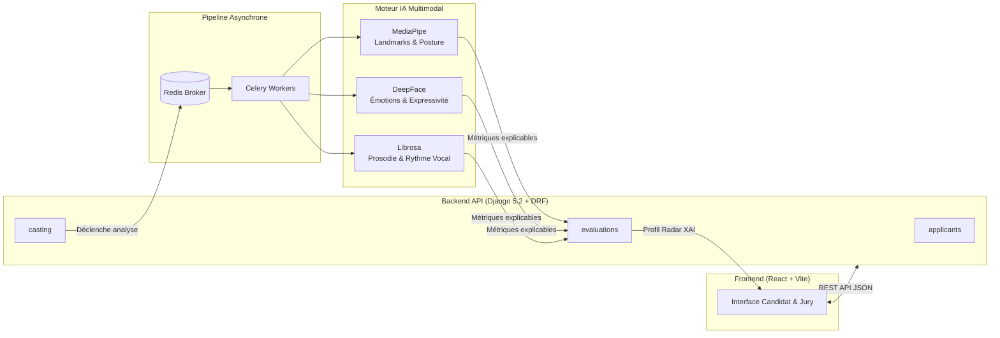

<div align="center">

# Cast AI

**Plateforme d'aide à la présélection artistique — objective, explicable et inclusive.**

`Hackathon IA Éthique 360` · `JEI INSAT × OIF • Mandat 2026/2027` · `Django 5.2` · `React + Vite` · `Celery + Redis`

[Démonstration Vidéo](#démonstration-vidéo) •
[Engagement IA Éthique 360](#engagement-ia-éthique-360) •
[Architecture Technique](#architecture-technique) •
[Installation Rapide](#installation-rapide)

</div>

---

## Présentation & Proposition de valeur

Dans les industries culturelle et cinématographique, la présélection des candidatures souffre fréquemment d'un manque de transparence, de biais inconscients et d'une volumétrie élevée qui pénalise les talents émergents — en particulier au sein de l'espace francophone.

**Cast AI** est une plateforme d'aide à la décision conçue pour les producteurs, directeurs de casting et jurys artistiques. Plutôt que de reposer sur un score global opaque, le moteur combine des indicateurs multimodaux objectifs (expressivité faciale, posture scénique, prosodie vocale, diction et cohérence avec le rôle) afin de générer un **profil d'évaluation radar explicable**, systématiquement soumis à la validation finale d'un jury humain.

```text
                  Expressivité (DeepFace)
                             ▲
                             │
   Cohérence Rôle     ───────┼───────     Posture (MediaPipe)
                             │
   Diction            ───────┼───────     Prosodie (Librosa)
                             │
                             ▼
                  Équité & Auditabilité
               [Décision finale : Humaine]
```

---

## Démonstration Vidéo

> **Aperçu du parcours complet :** dépôt d'une audition vidéo, traitement asynchrone via Celery/Redis, extraction des métriques multimodales et restitution du profil radar explicable.
>
> *Pour intégrer votre vidéo de démonstration : ouvrez `README.md` en mode édition sur GitHub.com et glissez-déposez votre fichier `.mp4` directement dans cette section — GitHub générera automatiquement un lecteur vidéo natif.*

---

## Engagement IA Éthique 360

Conçu dans le cadre du **Hackathon IA Éthique 360** co-organisé par la **Junior Entreprise INSAT (JEI)** et l'**Organisation Internationale de la Francophonie (OIF)** (*Mandat JEI 2026/2027*), **Cast AI** repose sur quatre principes fondamentaux :

| Pilier Éthique | Implémentation dans Cast AI |
| :--- | :--- |
| **Explicabilité (XAI)** | Aucun score global opaque : chaque évaluation est décomposée par critère artistique (prosodie, expressivité, posture, diction, cohérence) dans `evaluations`. |
| **Neutralisation des biais** | Analyse centrée exclusivement sur la performance artistique (repères géométriques et acoustiques) sans profilage morphologique ou identitaire. |
| **Supervision humaine (*Human-in-the-Loop*)** | L'IA assiste le tri initial et met en lumière des profils atypiques ; **la décision finale de casting reste 100 % humaine**. |
| **Inclusivité francophone** | Calibration acoustique ouverte à la diversité des accents et expressions culturelles de l'espace francophone (OIF). |

---

## Architecture Technique

La plateforme adopte une architecture découplée pensée pour absorber les traitements vidéo et audio lourds de manière asynchrone sans dégrader la réactivité de l'interface :



### Structure du dépôt

```text
spider-el-3ankabout/
├── backend/
│   ├── ai/                 # Extraction multimodale (MediaPipe, DeepFace, Librosa)
│   ├── applicants/         # Profils candidats et dépôt des auditions
│   ├── casting/            # Projets, scénarios et rôles de casting
│   ├── evaluations/        # Scores décomposés et critères explicables (XAI)
│   ├── config/             # Configuration Django, Celery et routage API
│   ├── manage.py
│   └── docker-compose.yml  # Broker Redis pour les tâches asynchrones
├── frontend/
│   ├── public/
│   ├── src/                # Composants React, visualisation Radar et client Axios
│   └── package.json
├── .gitignore
└── README.md
```

---

## Installation Rapide

### Prérequis

* **Python** 3.11+
* **Node.js** 18+ et **npm**
* **Docker** *(pour l'exécution de Redis)*

### 1. Cloner le dépôt

```bash
git clone [https://github.com/ismailkrid957-dot/spider-el-3ankabout.git](https://github.com/ismailkrid957-dot/spider-el-3ankabout.git)
cd spider-el-3ankabout
```

### 2. Démarrer le Backend & le Worker IA (`backend/`)

```bash
cd backend
```

**Créer et activer l'environnement virtuel :**

* **Windows (PowerShell) :**
  ```powershell
  python -m venv .venv
  .\.venv\Scripts\Activate.ps1
  ```
* **Linux / macOS :**
  ```bash
  python3 -m venv .venv
  source .venv/bin/activate
  ```

**Installer les dépendances et configurer les variables d'environnement :**

```bash
pip install -r requirements.txt
cp .env.example .env
```
*(Sous Windows PowerShell, utilisez `Copy-Item .env.example .env`.)*

**Générer une clé secrète Django et l'ajouter dans `.env` :**

```bash
python -c "from django.core.management.utils import get_random_secret_key; print(get_random_secret_key())"
```

**Démarrer Redis, appliquer les migrations et lancer le serveur :**

```bash
docker compose up -d
python manage.py migrate
python manage.py runserver
```

*(Optionnel — dans un second terminal depuis `backend/` avec `.venv` activé, démarrez le worker Celery : `celery -A config worker -l info`)*

API Backend accessible sur **http://127.0.0.1:8000/**.

### 3. Démarrer le Frontend (`frontend/`)

Dans un nouveau terminal, depuis la racine du projet :

```bash
cd frontend
npm install
npm run dev
```

Application Frontend accessible sur **http://localhost:5173/**.

---

## Cadre du projet

Projet développé dans le cadre du **Hackathon IA Éthique 360** — **Junior Entreprise INSAT (JEI) × Organisation Internationale de la Francophonie (OIF)** (*Mandat 2026/2027*).
