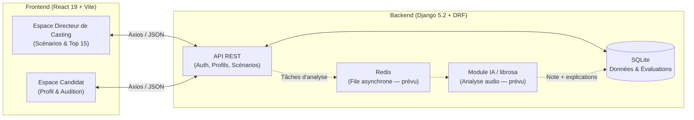

# Cast IA

**Plateforme d'aide à la présélection des candidats pour les castings.**


> **État du prototype :** L'architecture backend (authentification, profils, scénarios, modèles d'auditions et d'évaluations) est en place. L'interface React illustre le parcours produit avec des **données de démonstration fictives** : l'analyse automatique et le classement Top 15 réel sont en cours de développement.

---

## Présentation

**Cast IA** aide les producteurs et les directeurs de casting à trier un grand volume de candidatures afin d'identifier rapidement les profils les plus pertinents pour chaque rôle.

L'intelligence artificielle intervient uniquement comme **outil d'aide à la décision** : chaque score a vocation à être explicable, vérifiable, et le producteur conserve systématiquement le choix final.

### Parcours cible

1. **Définition du casting :** Le producteur ou directeur de casting crée un projet, ses rôles et ses critères d'évaluation.
2. **Dépôt des candidatures :** Les candidats complètent leur profil et soumettent leur audition vidéo pour un rôle.
3. **Analyse assistée :** Les auditions sont évaluées selon les critères définis pour le rôle.
4. **Notation explicable :** Chaque candidature reçoit une note accompagnée d'éléments justificatifs.
5. **Présélection Top 15 :** Cast IA met en avant les **15 candidats les mieux notés** par rôle.
6. **Validation humaine :** Le producteur visionne les auditions retenues et prend la décision finale.

---

## Aperçu de l'interface

| Vue Accueil & Concept | Classement Top 15 par rôle *(aperçu démo)* |
| :---: | :---: |
|  |  |
| *Présentation de la plateforme et accès par profil.* | *Simulation interactive du tri des 15 meilleurs profils.* |

---

## Architecture & Flux de données



*Les liaisons en pointillés représentent les composants d'analyse asynchrone prévus dans la feuille de route.*

### Structure du dépôt

```text
cast-ia/
├── backend/
│   ├── ai/                 # Extraction de caractéristiques et analyse des auditions
│   ├── applicants/         # Gestion des candidats et des auditions
│   ├── casting/            # Projets, scénarios et rôles de casting
│   ├── evaluations/        # Notes et critères d'évaluation
│   ├── config/             # Configuration Django et routage principal
│   ├── manage.py
│   └── docker-compose.yml  # Service Redis pour les tâches asynchrones
├── frontend/
│   ├── public/
│   ├── src/                # Composants React, pages et appels API (Axios)
│   └── package.json
├── docs/
│   └── screenshots/        # Captures d'écran de l'application
├── .gitignore
└── README.md
```

---

## Stack technique

| Couche | Technologies | Rôle dans le projet |
| :--- | :--- | :--- |
| **Backend** | Python, Django 5.2, Django REST Framework | API REST, authentification, gestion des rôles et modèles métier |
| **Base de données** | SQLite | Stockage relationnel en développement |
| **Asynchrone & Audio** | Redis, `librosa` | File de traitement des auditions et extraction de caractéristiques audio *(prévu)* |
| **Frontend** | React 19, Vite, JavaScript, React Router, Axios | Interface utilisateur et communication avec l'API |

---

## Avancement du projet

| Fonctionnalité | Statut | Détails |
| :--- | :---: | :--- |
| Authentification & comptes (`directeur de casting` / `candidat`) | ✅ Implémenté | Création automatique du profil à l'inscription |
| Modèles & API des scénarios de casting | ✅ Implémenté | Lecture authentifiée, création réservée aux directeurs de casting |
| Modèles de données auditions & évaluations | ✅ Implémenté | Structure initiale avec champ de note globale |
| Interface de démonstration du Top 15 | 🟡 Maquette | Données fictives côté frontend |
| Modèle des rôles liés aux castings | ⏳ À développer | Rattachement des auditions et critères à chaque rôle |
| Upload et lecture des vidéos d'audition | ⏳ À développer | Gestion des fichiers médias via l'API |
| Analyse automatique (`Redis` + `librosa`) & Top 15 réel | ⏳ À développer | Calcul de scores justifiables et connexion au dashboard producteur |

---

## Installation et lancement

### Prérequis

* **Python** 3.11+
* **Node.js** 18+ et **npm**
* **Docker** *(facultatif, uniquement pour lancer Redis)*

### 1. Cloner le dépôt

```bash
git clone https://github.com/ismailkrid957-dot/spider-el-3ankabout.git
cd spider-el-3ankabout
```

### 2. Lancer le Backend (`backend/`)

```bash
cd backend
```

**Créer et activer l'environnement virtuel :**

* **Windows (PowerShell) :**
  ```powershell
  python -m venv .venv
  .\.venv\Scripts\Activate.ps1
  ```
* **Linux / macOS :**
  ```bash
  python3 -m venv .venv
  source .venv/bin/activate
  ```

**Installer les dépendances et configurer l'environnement :**

```bash
pip install -r requirements.txt
cp .env.example .env
```
*(Sous Windows PowerShell, utilisez `Copy-Item .env.example .env` si `cp` n'est pas disponible.)*

**Générer une clé secrète Django et l'ajouter dans `.env` :**

```bash
python -c "from django.core.management.utils import get_random_secret_key; print(get_random_secret_key())"
```

**Appliquer les migrations et démarrer le serveur :**

```bash
python manage.py migrate
python manage.py runserver
```

Le backend est accessible sur **[http://127.0.0.1:8000/](http://127.0.0.1:8000/)**.

### 3. Lancer le Frontend (`frontend/`)

Dans un second terminal, depuis la racine du projet :

```bash
cd frontend
npm install
npm run dev
```

Le frontend est accessible sur **http://localhost:5173/**.

### 4. Lancer Redis *(facultatif)*

Depuis le dossier `backend/` :

```bash
docker compose up -d
```

---

## Auteur

Projet académique et technique — **Cast IA**.
